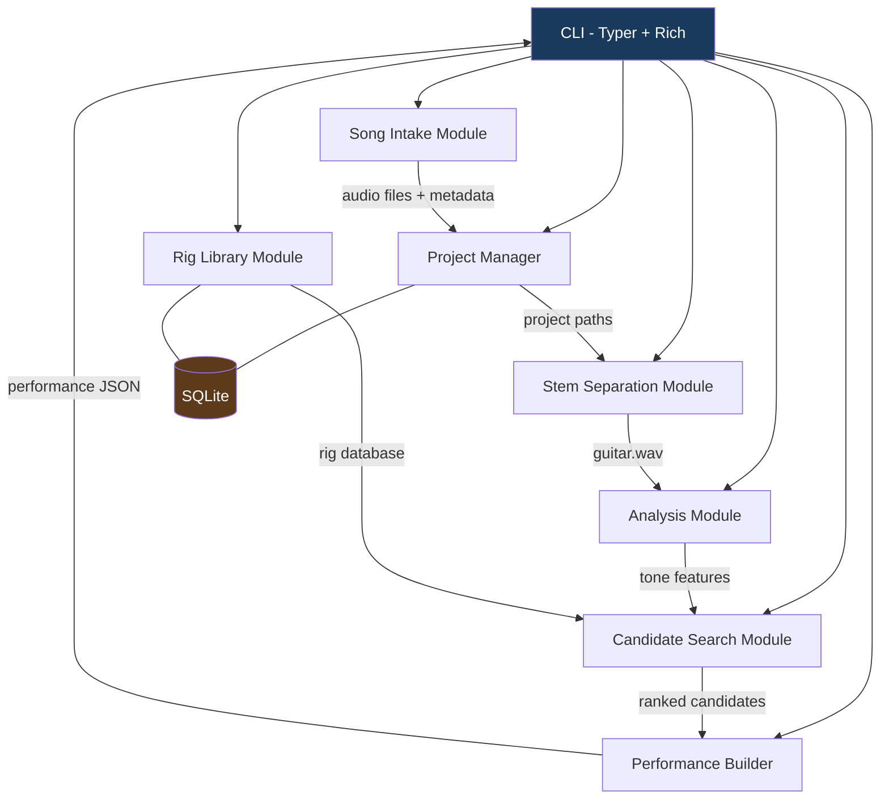
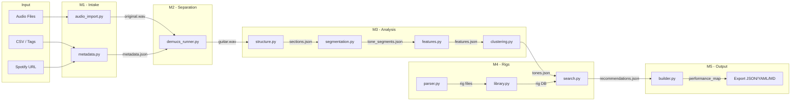

# Song-to-Kemper Rig Matcher — Development Plan

## Target Environment

| Item | Value |
|---|---|
| OS | Windows 11 (native) |
| Python | 3.11 or 3.12 from python.org |
| Env Manager | venv + pip |
| GPU | None — CPU only |
| IDE | VS Code |
| Audio | ffmpeg (standalone), PortAudio bundled with sounddevice |

---

## Project Structure

```text
rig_pipeline/
├── pyproject.toml
├── README.md
├── src/
│   └── kemper_match/
│       ├── __init__.py
│       ├── cli/
│       │   ├── __init__.py
│       │   └── main.py              # Typer app, top-level CLI entry
│       ├── config.py                 # Config loader + defaults
│       ├── project.py                # Project init + path resolution
│       ├── intake/
│       │   ├── __init__.py
│       │   ├── audio_import.py       # Local file import + normalization
│       │   ├── metadata.py           # Tag reading, CSV, Spotify metadata
│       │   └── spotify.py            # Spotify API client (metadata only)
│       ├── separation/
│       │   ├── __init__.py
│       │   └── demucs_runner.py      # Demucs stem separation wrapper
│       ├── analysis/
│       │   ├── __init__.py
│       │   ├── structure.py          # Song structure detection
│       │   ├── segmentation.py       # Guitar tone segmentation
│       │   ├── clustering.py         # Tone clustering
│       │   └── features.py           # Feature extraction
│       ├── rigs/
│       │   ├── __init__.py
│       │   ├── library.py            # Rig library management + SQLite
│       │   ├── parser.py             # Kemper file parser
│       │   ├── rigmanager.py         # Reader for Rig Manager's repositoryR2.db libraries
│       │   └── search.py             # Candidate search + ranking
│       ├── performance/
│       │   ├── __init__.py
│       │   └── builder.py            # Performance slot layout (stub for Phase 1)
│       └── db/
│           ├── __init__.py
│           └── models.py             # SQLite schema + queries
├── tests/
│   ├── __init__.py
│   ├── conftest.py
│   ├── test_intake.py
│   ├── test_separation.py
│   ├── test_analysis.py
│   ├── test_rigs.py
│   └── fixtures/
│       └── (small test audio clips, sample metadata)
├── scripts/
│   └── sync_rigmanager_data.py       # Snapshot Rig Manager DBs + songs into data/
├── data/                             # Local inputs, git-ignored (see data/README.md)
└── plans/
    └── development-plan.md
```

---

## Architecture Overview



---

## Dependency Map

These are the Phase 1 dependencies only. Phase 2+ dependencies like Optuna and sounddevice are excluded.

```text
# Core
torch              (CPU-only build)
torchaudio         (CPU-only build)
demucs             (stem separation)

# Audio Analysis
librosa            (spectral analysis, structure detection)
scipy              (signal processing, clustering)
numpy              (numerical operations)
soundfile          (audio I/O — used by librosa)

# CLI
typer              (CLI framework)
rich               (terminal formatting)
tqdm               (progress bars)

# Data
pandas             (optional — metadata/CSV handling)
pyloudnorm         (loudness normalization)

# Storage
sqlite3            (built-in — no install needed)

# Metadata
mutagen            (audio file tag reading)
spotipy            (Spotify API — optional, metadata only)

# Clustering
hdbscan            (tone clustering)
scikit-learn       (preprocessing, agglomerative clustering fallback)

# Testing
pytest
pytest-cov

# Packaging
setuptools         (or hatchling)
```

### essentia Note

The design doc lists `essentia`. On Windows, essentia has improved but can still be problematic. The plan uses **librosa as the primary analysis engine** and treats essentia as an optional enhancement. Every analysis task in the design doc can be accomplished with librosa + scipy.

---

## Rig Manager Data Layout (findings)

Rig Manager 4.x keeps everything under `%LOCALAPPDATA%\Kemper Amps\RigManager`
(from WSL: `/mnt/c/Users/<user>/AppData/Local/Kemper Amps/RigManager`):

| Path | Holds |
|---|---|
| `Local Library/repositoryR2.db` | the hand-curated local rig library |
| `Local Library/<pack>/…/repositoryR2.db` | one DB per sub-folder: profile packs (the 80k Profile Pack alone is 80 565 rigs / 500 MB) |
| `Prf/Local Library/…/repositoryR2.db` | performances |
| `Prst/Local Library/…/repositoryR2.db` | presets (cabs, IRs, effects) |
| `Rig Packs/*.rigpack` | installed factory packs |
| `RigExchangeR2.db`, `RigExchange.xml` | Rig Exchange cache |
| `Backups/*.db`; `…\Documents\Kemper Amps\RigManager\PROFILER Backups\*.rmbackup` | backups (`.rmbackup` is a zip of the same DBs) |

Each rig DB: table `Rigs` (one row per rig; ~36 text columns incl. `Name`,
`Author`, `Gain` (0–10), `Amp Name`, `Cabinet Name`, `Mic Type`, `Speaker Model`,
`Profile Type`) and `Rigs_blobs` (same id; `data` is the raw rig, identical to a
`.krig` file). Performances and presets live in sibling DBs and are not used.

Rig file container: `KThd` + `KTrk` chunks (SMF-style); the track is a sequence of
Kemper SysEx messages (`00 20 33`, function byte, body). String parameters are
decoded; numeric and block parameters are not. See `src/kemper_match/rigs/parser.py`.

`scripts/sync_rigmanager_data.py` snapshots the local library, four small packs
and two songs into `data/` (git-ignored; see `data/README.md`).

---

## Phase 1 — Offline Analyzer: Step-by-Step Checklist

### Milestone 0: Environment Bootstrap

- [ ] **0.1** Install Python 3.11 or 3.12 from python.org (ensure "Add to PATH" is checked)
- [ ] **0.2** Install ffmpeg (via scoop: `scoop install ffmpeg`, or download from gyan.dev and add to PATH)
- [ ] **0.3** Verify ffmpeg: `ffmpeg -version`
- [ ] **0.4** Create venv: `python -m venv .venv`
- [ ] **0.5** Activate venv: `.venv\Scripts\activate`
- [ ] **0.6** Install PyTorch CPU-only: `pip install torch torchaudio --index-url https://download.pytorch.org/whl/cpu`
- [ ] **0.7** Install remaining dependencies: `pip install demucs librosa scipy numpy soundfile typer rich tqdm pyloudnorm mutagen hdbscan scikit-learn pandas pytest pytest-cov`
- [ ] **0.8** Verify imports: `python -c "import torch; import demucs; import librosa; import typer; print('All OK')"`
- [x] **0.9** Create `pyproject.toml` with project metadata, dependencies, and `[project.scripts]` entry point for `kemper-match`

### Milestone 1: Project Scaffolding + CLI Skeleton

- [x] **1.1** Create the directory structure shown above under `src/kemper_match/`
- [x] **1.2** Implement `kemper_match/cli/main.py` — Typer app with stub commands: `init`, `import-audio`, `import-playlist`, `separate`, `analyze`, `import-rigs`, `recommend`, `export`
- [x] **1.3** Implement `kemper_match/project.py` — `init` command creates the project directory structure:
  ```text
  my_project/
    config.yaml
    songs/
    stems/
    analysis/
    rigs/
    renders/
    exports/
  ```
- [x] **1.4** Implement `kemper_match/config.py` — load/save `config.yaml` with defaults (sample rate, stem separation model, etc.)
- [x] **1.5** Wire up the CLI entry point in `pyproject.toml` so `kemper-match init ./my_project` works
- [x] **1.6** Write tests for project init (directory creation, config defaults)

**Validation checkpoint:** `kemper-match init ./test_project` creates the expected directory tree and config file.

---

### Milestone 2: Song Intake Module

- [ ] **2.1** Implement `intake/audio_import.py`:
  - Accept a folder path or list of file paths
  - Validate supported formats (WAV, FLAC, MP3, AAC, AIFF)
  - Copy/convert files to project `songs/<song_id>/original.wav` using ffmpeg
  - Generate a unique `song_id` from filename + hash
- [ ] **2.2** Implement `intake/metadata.py`:
  - Read tags from audio files using `mutagen` (title, artist, album)
  - Accept CSV manifest as alternative metadata source
  - Save `songs/<song_id>/metadata.json`
- [ ] **2.3** Implement `intake/spotify.py` (optional — can be deferred):
  - Accept Spotify playlist URL
  - Use `spotipy` to fetch track list metadata (title, artist, album, track order)
  - Save metadata only — no audio
- [ ] **2.4** Wire `import-audio` and `import-playlist` CLI commands to the intake module
- [ ] **2.5** Add Rich progress output during import (file count, conversion progress)
- [ ] **2.6** Write tests: valid file import, invalid format rejection, metadata extraction, duplicate handling

**Validation checkpoint:** `kemper-match import-audio ./my_songs --project ./test_project` imports audio files, converts to WAV, saves metadata JSON.

---

### Milestone 3: Stem Separation Module

- [ ] **3.1** Implement `separation/demucs_runner.py`:
  - Wrap Demucs CLI or Python API
  - Accept a song path, run separation, output stems to `stems/<song_id>/`
  - Output files: `guitar.wav`, `vocals.wav`, `bass.wav`, `drums.wav`, `other.wav`
  - Handle CPU-only execution (no CUDA device selection)
- [ ] **3.2** Add model selection in config (default: `htdemucs`, option: `htdemucs_ft` for higher quality but slower)
- [ ] **3.3** Wire `separate` CLI command — single song and `--all` batch mode
- [ ] **3.4** Add Rich progress output (tqdm for batch, status spinners for single song)
- [ ] **3.5** Write tests: verify output file creation, handle missing input gracefully, verify stems are valid audio

**Validation checkpoint:** `kemper-match separate --project ./test_project --song <song_id>` produces 5 stem files. `kemper-match separate --project ./test_project --all` processes all imported songs.

---

### Milestone 4: Song Structure Detection (Analysis Submodule A)

- [ ] **4.1** Implement `analysis/structure.py`:
  - Load guitar stem via librosa
  - Compute self-similarity matrix (chroma-based)
  - Compute novelty curve from self-similarity
  - Detect segment boundaries using peak-picking on novelty curve
  - Label segments heuristically: intro, verse, chorus, bridge, solo, outro (based on energy, onset density, spectral characteristics)
- [ ] **4.2** Output `analysis/<song_id>/sections.json`:
  ```json
  [
    {"section_id": "intro_01", "label": "intro", "start": 0.0, "end": 12.4},
    {"section_id": "verse_01", "label": "verse", "start": 12.4, "end": 44.0}
  ]
  ```
- [ ] **4.3** Wire into `analyze` CLI command
- [ ] **4.4** Write tests with a known song structure (can use a synthetic test audio)

**Validation checkpoint:** `kemper-match analyze --project ./test_project --song <song_id>` produces `sections.json` with reasonable section boundaries.

---

### Milestone 5: Guitar Tone Segmentation (Analysis Submodule B)

- [ ] **5.1** Implement `analysis/segmentation.py`:
  - Load guitar stem
  - Extract frame-level features using librosa:
    - Spectral centroid
    - Spectral rolloff / tilt
    - RMS energy
    - Spectral contrast
    - Spectral flatness
    - Zero crossing rate (proxy for distortion density)
  - Detect tone change points using feature discontinuities (cosine distance between adjacent windows)
  - Merge with structural boundaries from Milestone 4
- [ ] **5.2** Output `analysis/<song_id>/tone_segments.json`:
  ```json
  [
    {"segment_id": "seg_01", "start": 0.0, "end": 12.4, "section_id": "intro_01"},
    {"segment_id": "seg_02", "start": 12.4, "end": 44.0, "section_id": "verse_01"}
  ]
  ```
- [ ] **5.3** Write tests: synthetic audio with clean/distorted transitions should produce distinct segments

**Validation checkpoint:** Tone segments align with audible tone changes in the guitar stem.

---

### Milestone 6: Feature Extraction Module

- [ ] **6.1** Implement `analysis/features.py`:
  - For each tone segment, compute aggregate features:
    - **Spectral:** centroid, rolloff, contrast, flatness, bandwidth (mean + std over segment)
    - **Dynamic:** RMS, crest factor, transient sharpness (onset strength envelope)
    - **Distortion:** harmonic density (spectral flatness inverse), odd/even harmonic balance
    - **Musical:** tempo estimate, note density (onset count / duration)
  - Normalize features to 0–1 range
- [ ] **6.2** Output `analysis/<song_id>/features.json`:
  ```json
  {
    "seg_01": {
      "gain_estimate": 0.23,
      "brightness": 0.45,
      "tightness": 0.67,
      "transient_aggression": 0.31,
      "spectral_centroid_mean": 0.52
    }
  }
  ```
- [ ] **6.3** Write tests: features for a clean segment should differ meaningfully from a distorted segment

**Validation checkpoint:** Feature vectors are numerically stable and discriminative across different tone types.

---

### Milestone 7: Tone Clustering (Analysis Submodule C)

- [ ] **7.1** Implement `analysis/clustering.py`:
  - Collect feature vectors for all tone segments in a song
  - Run HDBSCAN clustering (with scikit-learn agglomerative as fallback)
  - Assign tone IDs: `tone_A`, `tone_B`, etc.
  - Map: which segments belong to which tone cluster
- [ ] **7.2** Update output to `analysis/<song_id>/tones.json`:
  ```json
  {
    "tone_A": {"label": "clean intro", "segments": ["seg_01", "seg_05"]},
    "tone_B": {"label": "verse crunch", "segments": ["seg_02", "seg_04"]},
    "tone_C": {"label": "chorus rhythm", "segments": ["seg_03", "seg_06"]}
  }
  ```
- [ ] **7.3** Auto-label clusters based on gain_estimate (clean / edge / crunch / high_gain) and brightness
- [ ] **7.4** Wire full analysis pipeline into `analyze` CLI command (structure → segmentation → features → clustering)
- [ ] **7.5** Write tests: identical segments should cluster together, different tones should separate

**Validation checkpoint:** `kemper-match analyze` produces `sections.json`, `tone_segments.json`, `features.json`, and `tones.json`. Clusters match audible tone groupings.

---

### Milestone 8: Rig Library Module

Rig Manager's library is not loose rig files but SQLite (one `repositoryR2.db` per
folder, see "Rig Manager Data Layout" above), so the primary source for 8.3 is that
database; the loose-file parser is the secondary path and the only route to
per-parameter data.

- [x] **8.0** Implement `rigs/rigmanager.py` — read `Rigs` / `Rigs_blobs` from `repositoryR2.db`, export blobs as `.krig`
- [ ] **8.1** Implement `db/models.py`:
  - Define SQLite schema for rigs table:
    - `rig_id`, `rig_name`, `file_path`, `amp_family`, `gain_category`, `cab_type`
    - `brightness`, `tightness`, `tags` (JSON array)
    - `feature_vector` (JSON — for similarity search)
  - Create/migrate database at `<project>/rigs.db`
- [ ] **8.2** Implement `rigs/parser.py`:
  - [x] Read `.krig` / `.kipr` containers (KThd/KTrk chunks, SysEx messages) and their string parameters (name, author, cabinet name, …)
  - [ ] Decode the numeric parameters (gain, amp/cab identity, stack, effect slots); `.kpreset` untested
  - For unknown formats: fall back to filename parsing + user-provided tags
- [ ] **8.3** Implement `rigs/library.py`:
  - Scan a Rig Manager folder (`repositoryR2.db` files, via `rigs/rigmanager.py`) or a directory of loose rig files
  - Parse and index into SQLite
  - Support re-indexing (update existing, add new)
  - Query by amp_family, gain_category, tags
- [ ] **8.4** Wire `import-rigs` CLI command
- [ ] **8.5** Write tests: import a directory of rigs, verify database contents, query by family/gain

**Validation checkpoint:** `kemper-match import-rigs ./kemper_rigs --project ./test_project` indexes rig files into SQLite. Queries return expected results.

---

### Milestone 9: Candidate Rig Search + Ranking

- [ ] **9.1** Implement `rigs/search.py`:
  - **Step 1 — Amp Family Classification:** Given a tone's feature vector, classify likely amp family using a rule-based classifier (spectral centroid ranges, gain estimate, tightness → family mapping)
  - **Step 2 — Gain Classification:** Map gain_estimate to category (clean / edge / crunch / hard_rock / high_gain / extreme)
  - **Step 3 — Similarity Search:** Compute weighted distance between tone features and rig feature vectors
  - **Ranking formula:**
    ```
    score = 0.30 * amp_family_match
          + 0.25 * gain_match
          + 0.25 * spectral_match
          + 0.10 * transient_match
          + 0.10 * user_history
    ```
  - Return top N candidates (default 5) per tone
- [ ] **9.2** Wire `recommend` CLI command:
  - Read analysis outputs for a song
  - For each tone cluster, run search
  - Output recommendations to `analysis/<song_id>/recommendations.json`
- [ ] **9.3** Rich table output in terminal showing tone → top rigs with confidence scores
- [ ] **9.4** Write tests: mock rig database, verify ranking order, verify family/gain filtering

**Validation checkpoint:** `kemper-match recommend --project ./test_project --song <song_id>` outputs a ranked list of rig candidates per tone.

---

### Milestone 10: Performance Builder (Stub) + Export

- [ ] **10.1** Implement `performance/builder.py`:
  - Take recommendations + tone timeline
  - Map top-ranked rig per tone to Kemper Performance slots (max 5 slots)
  - If more than 5 tones: merge least-different tones or prioritize by section duration
  - Generate performance map with timeline
- [ ] **10.2** Wire `export` CLI command:
  - Output formats: JSON, YAML, Markdown
  - JSON output matches the example schema from the design doc
  - Markdown output: human-readable performance sheet
- [ ] **10.3** Write tests: verify slot assignment logic, verify export format correctness

**Validation checkpoint:** `kemper-match export --project ./test_project --song <song_id> --format json` produces a complete performance plan matching the design doc schema.

---

### Milestone 11: Integration + Polish

- [ ] **11.1** End-to-end test: import → separate → analyze → recommend → export for a real song
- [ ] **11.2** Error handling: graceful failures with Rich error panels for missing ffmpeg, corrupt audio, empty rig library
- [ ] **11.3** Add `--verbose` / `--quiet` flags to all commands
- [x] **11.4** Add `kemper-match status --project ./my_project` command showing pipeline progress per song (basic version: checks which output files exist)
- [ ] **11.5** Write README.md with installation instructions, usage examples, and project overview
- [ ] **11.6** Verify the full pipeline on 2–3 real songs with actual Kemper rigs

**Validation checkpoint:** A user can go from raw audio files to a Kemper performance plan using only CLI commands, with clear feedback at every step.

---

## Data Flow Diagram



---

## Phases 2–5 Summary (Future — Not in Scope Now)

| Phase | Adds | Key New Dependencies |
|---|---|---|
| Phase 2 — DI/Reamp Loop | DI recording, Kemper render capture, A/B comparison | sounddevice |
| Phase 3 — Optimization | Kemper parameter optimization, post-EQ generation | Optuna or Nevergrad |
| Phase 4 — Performance Builder | Full slot layout, timeline switching, setlists | (none new) |
| Phase 5 — Automation | MIDI control, auto Kemper switching, live sync | mido, python-rtmidi |

These phases build on the Phase 1 foundation. The architecture above is designed to accommodate them without restructuring.

---

## Key Design Decisions

1. **librosa over essentia** — librosa has reliable Windows wheels and covers all required analysis tasks. essentia can be added later as an optional enhancement.

2. **HDBSCAN for clustering** — handles variable cluster counts without requiring the user to specify how many tones a song has. Falls back to agglomerative clustering if HDBSCAN produces degenerate results.

3. **Rule-based amp family classification** — Phase 1 uses heuristic rules based on spectral features. This can be upgraded to a trained classifier in later phases if needed.

4. **SQLite for rig storage** — zero-config, single-file database. No server needed. Keeps everything portable within the project directory.

5. **CPU-only PyTorch** — avoids CUDA dependency entirely. Demucs on CPU is ~3–8 min/song which is acceptable for offline batch processing.

6. **Kemper file parsing is best-effort** — Kemper file formats are not fully documented. The parser extracts what it can and falls back to filename-based metadata + manual tagging.

7. **Heavy dependencies are optional extras** — torch/demucs (`separation`), hdbscan (`clustering`), spotipy (`spotify`) and pandas (`data`) are not in the base install so `pip install -e .` stays quick; install what a milestone needs.

8. **Rig Manager's SQLite is the primary rig source** — its `Rigs` table already carries amp/cab/gain metadata, so indexing starts from `repositoryR2.db`; loose `.krig` parsing is the fallback and the only path to per-parameter data.
